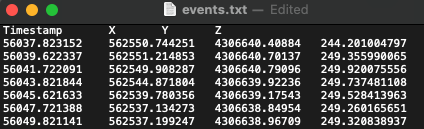

# 0 · GPS Embedder

**Stage 1 · Prepare imagery** · **Type: Form** · [← Back to MatchPlant](../README.md)

Embed GPS coordinates into UAV image EXIF metadata before orthomosaic generation. The tool matches each image's timestamp with a position in an `events.txt` log, converts the UTM coordinates to latitude/longitude (WGS84), and writes them into copies of the images.

| | |
| --- | --- |
| **Use it when** | Your UAV system records GPS positions separately from image capture, so the images have no GPS tags. Skip this step if your images already have GPS in their EXIF data. |
| **Input** | A folder with the JPG images and a tab-delimited `events.txt` |
| **Output** | `images_with_gps/` (GPS-tagged copies) and `events_with_matches.csv`, inside the same folder |
| **Next step** | [1 GCP Finder](../1_gcp_finder/README.md) or [2 ODM Runner](../2_odm_runner/README.md) |

## Run it from the dashboard

1. On the dashboard home, select **GPS Embedder**.
2. If the page reports missing packages, click **Install requirements** and wait for it to finish.
3. Enter the **UTM zone** (1–60) of your event coordinates, for example `15` for Columbia, MO, USA.
4. Choose the **Hemisphere**: `N` for Northern or `S` for Southern.
5. Click **Browse…** and choose the **Images folder** that contains the JPG images and `events.txt`.
6. Click **Run** and follow the **Output** panel until it finishes.
7. Use the new `images_with_gps/` folder as the image input for the next step.

## Inputs

Put the images and `events.txt` in one folder:

```text
your_input_folder/
├── events.txt
├── IMG_0001.jpg
├── IMG_0002.jpg
└── ...
```

- **Images**: JPG/JPEG files with an EXIF timestamp (original camera files, not screenshots or edited copies). Keep file names in capture order.
- **events.txt**: must be named exactly `events.txt`, tab-delimited, with columns for timestamp (seconds), X (UTM Easting), Y (UTM Northing), and Z (altitude).



*Example of an `events.txt` file*

## Outputs

```text
your_input_folder/
├── events.txt
├── IMG_0001.jpg                  # originals are not changed
├── events_with_matches.csv       # matched events and timing error for each image
└── images_with_gps/
    └── IMG_0001.jpg              # copy with GPS written to EXIF
```

## Run without the dashboard

From this folder:

```bash
pip install -r requirements.txt
python gps_embed.py --utm-zone 15 --hemisphere N --images-folder "path/to/images"
```

Provide all three arguments together, or run `python gps_embed.py` with no arguments to answer the questions interactively. Use your own zone and hemisphere.

<details>
<summary>Use it from Python</summary>

```python
from gps_embed import TimestampMatcher

matcher = TimestampMatcher()
matcher.set_utm_zone(15, 'N')
image_files = matcher.get_image_files('path/to/images')
matcher.load_events_file('path/to/events.txt')
matcher.find_initial_offset(image_files[0])
matcher.save_matched_events('events.txt', 'events_with_matches.csv')
matcher.embed_gps_to_images('input_folder', 'images_with_gps')
```

</details>

## Troubleshooting

- **No EXIF data:** use the original camera files and check that the camera saves EXIF metadata.
- **Timestamps do not match:** check the camera clock, the timestamp format in `events.txt`, and that images are in capture order.
- **Positions look wrong:** confirm the UTM zone and hemisphere for your field, and the X/Y column order in `events.txt`.

## License

MIT License. See [LICENSE](../LICENSE).
