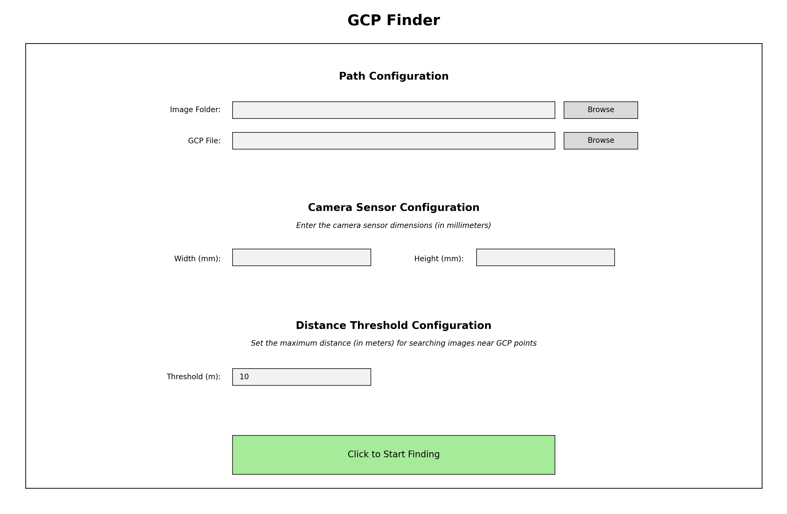
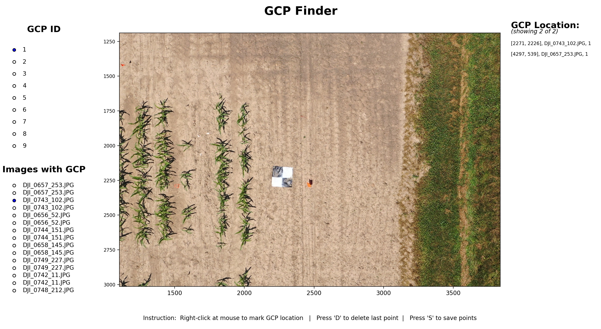

# 1 · GCP Finder

**Stage 1 · Prepare imagery** · **Type: Desktop app** · [← Back to MatchPlant](../README.md)

Mark Ground Control Points (GCPs) in your UAV images and build the `gcp_list.txt` file that [OpenDroneMap](https://github.com/OpenDroneMap/ODM) uses to make a more accurate orthomosaic. The tool finds the images that are likely to contain each GCP; you right-click the GCP in each image to mark it.

| | |
| --- | --- |
| **Use it when** | You placed GCPs in the field and have their surveyed coordinates. Skip it if you are not using GCPs. |
| **Input** | A folder of UAV images with GPS in EXIF, and a CSV of GCP coordinates |
| **Output** | `gcp_list.txt` in the image folder |
| **Previous step** | [0 GPS Embedder](../0_gps_embeder/README.md) (only if your images lack GPS) |
| **Next step** | [2 ODM Runner](../2_odm_runner/README.md): put `gcp_list.txt` in the project's `images/` folder |

## Run it from the dashboard

1. On the dashboard home, select **GCP Finder**.
2. If the page reports missing packages, click **Install requirements** and wait for it to finish.
3. Check the **Operating system** selection (it is set for your computer automatically), then click **Launch**. A GCP Finder window opens.
4. In the window, fill in the required information:
   - **Image Folder**: click **Browse...** and choose your image folder.
   - **GCP File**: click **Browse...** and choose your GCP CSV file.
   - **Camera sensor** width and height in millimeters (see [camera sensor dimensions](camera_sensor_dimension.md)).
   - **Distance threshold** in meters (default 10 m).
5. Click **Click to Start Finding**.
6. Mark each GCP (see [Marking GCPs](#marking-gcps)) and press **S** to save `gcp_list.txt`.

Keep the dashboard running while you use the window. Messages and errors appear in the dashboard **Output** panel.



*GCP Finder setup window*

## Inputs

- **Images**: JPG/JPEG/TIF/TIFF files in one folder, with GPS coordinates in EXIF.
- **GCP file (CSV)** with columns `X` (longitude/easting), `Y` (latitude/northing), `Z` (elevation), and `id`:

  ```text
  X,Y,Z,id
  -123.456,45.789,100.5,1
  -123.457,45.790,102.3,2
  ```

### Distance threshold

How far (in meters) from a GCP the tool searches for images. The maximum is 50 m.

- Dense coverage or low flights: 5–10 m (fewer, closer images).
- Sparse coverage or higher flights: 15–20 m (more images, but the GCP may be harder to see).

## Marking GCPs

1. Select a GCP ID from the radio buttons.
2. Choose an image from the list.
3. Right-click the center of the GCP to mark it.
4. Repeat for the other images and GCPs, then press **S** to save.

| Control | Action |
| --- | --- |
| Right-click | Mark the GCP location |
| Left-click and drag | Pan the image |
| Scroll wheel | Zoom in/out |
| **S** | Save marked points to `gcp_list.txt` |
| **D** | Delete the last point |



*GCP marking window*

## Outputs

`gcp_list.txt` is saved in your image folder, in the format OpenDroneMap expects:

```text
WGS84 UTM [zone][hemisphere]
[UTM_X] [UTM_Y] [Elevation] [ImageX] [ImageY] [Filename] [GCP_ID]
```

Copy it into the `images/` folder of your [ODM Runner](../2_odm_runner/README.md) project.

## Run without the dashboard

From this folder, install the requirements for your system and start the tool:

```bash
# Windows
pip install -r requirements_win.txt
python gcp_finder_win.py

# macOS
pip install -r requirements_mac.txt
python gcp_finder_mac.py
```

Keep the repository's [matchplant_ui](../matchplant_ui/README.md) folder beside this module; the Browse buttons use it.

## Troubleshooting

- **No images listed:** check the image folder, that images have GPS in EXIF, that the GCP coordinates fall inside the flight area, and try a larger distance threshold.
- **Coordinate errors:** check the GCP CSV columns and that all coordinates use the same system.
- **Images do not load:** use a supported format and check file permissions.
- **Windows folder picker shows no files:** this is normal; the folder picker selects folders only.

## License

MIT License. See [LICENSE](../LICENSE).
