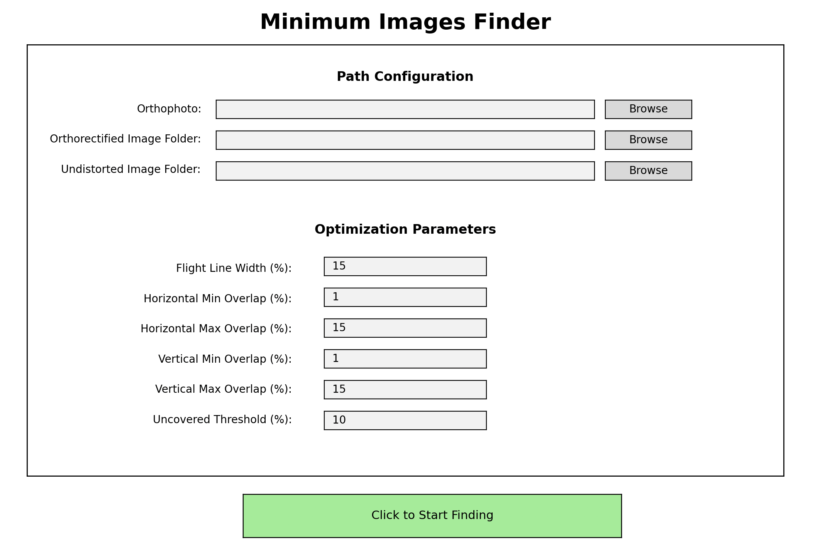
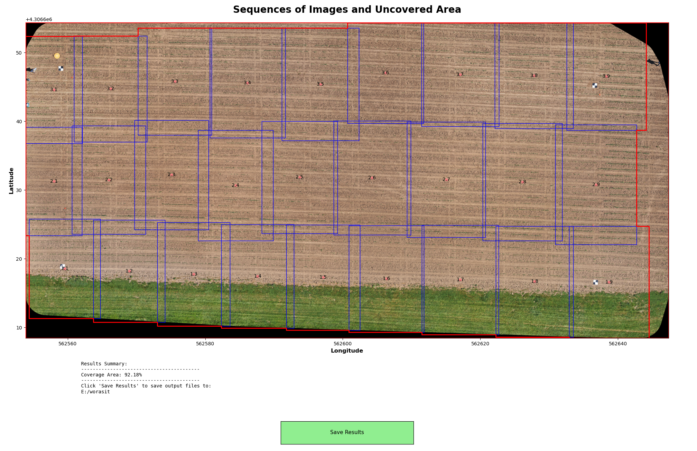

# 3 · Minimum Image Finder

**Stage 2 · Build the dataset** · **Type: Desktop app** · [← Back to MatchPlant](../README.md)

Select the smallest set of UAV images that still covers all plants of interest, to minimize labeling effort. You set overlap limits; the tool compares each image's footprint with the orthomosaic and picks images until the field is covered.

| | |
| --- | --- |
| **Input** | From [2 ODM Runner](../2_odm_runner/README.md): the orthomosaic, the orthorectified image folder, and the undistorted image folder |
| **Output** | `selected_undistorted_images_<timestamp>/`, a CSV list of selected images, and a coverage plot |
| **Previous step** | [2 ODM Runner](../2_odm_runner/README.md) |
| **Next step** | [4 BBox Drawer](../4_bbox_drawer/README.md): label the selected images |

## Run it from the dashboard

1. On the dashboard home, select **Minimum Image Finder**.
2. If the page reports missing packages, click **Install requirements** and wait for it to finish.
3. Check the **Operating system** selection, then click **Launch**. A Minimum Images Finder window opens.
4. Under **Path Configuration**, click **Browse...** for each field:
   - **Orthomosaic**: `odm_orthophoto/odm_orthophoto.tif`
   - **Orthorectified Image Folder**: `orthorectified/`
   - **Undistorted Image Folder**: `opensfm/undistorted/images/`
5. Under **Optimization Parameters**, keep the defaults or adjust them (click **Parameter guide** for help).
6. Click **Click to Start Finding**.
7. Review the coverage map, then click **Save Results**.

Keep the dashboard running while you use the window. Messages and errors appear in the dashboard **Output** panel.



*Setup window*

## Inputs

All inputs come from the ODM project folder made by [2 ODM Runner](../2_odm_runner/README.md):

```text
your_drone_project/
├── odm_orthophoto/
│   └── odm_orthophoto.tif        # Orthomosaic
├── opensfm/
│   └── undistorted/
│       └── images/               # Undistorted Image Folder
└── orthorectified/               # Orthorectified Image Folder
```

The orthorectified (GeoTIFF) images are used to measure coverage; the matching undistorted images are copied into the final dataset.

## Optimization parameters

| Parameter | Default | What it controls |
| --- | --- | --- |
| Flight Line Width (%) | 15 | Spacing between selected images |
| Horizontal Min / Max Overlap (%) | 1 / 15 | Overlap between neighboring images along a flight line |
| Vertical Min / Max Overlap (%) | 1 / 15 | Overlap between flight lines |
| Uncovered Threshold (%) | 10 | Acceptable uncovered area |

See the [parameter guide](configuration_parameters_guide.md) for details and examples.

- **Gaps in coverage:** decrease flight line width, increase the overlap values, or lower the uncovered threshold.
- **Too many images:** increase flight line width, decrease maximum overlap, or raise the uncovered threshold.

## Outputs

Saved next to your image folders, with a timestamp in each name:

```text
├── selected_undistorted_images_YYYYMMDD_HHMMSS/   # your dataset → BBox Drawer
├── selected_images_list_YYYYMMDD_HHMMSS.csv       # selected images and coverage
└── coverage_plot_YYYYMMDD_HHMMSS.png              # coverage map
```



*Result window with the coverage map*

## Run without the dashboard

From this folder, install the requirements for your system and start the tool:

```bash
# Windows
pip install -r requirements_win.txt
python min_img_finder_win.py

# macOS
pip install -r requirements_mac.txt
python min_img_finder_mac.py
```

Keep the repository's [matchplant_ui](../matchplant_ui/README.md) folder beside this module; the Browse buttons use it.

## Troubleshooting

- **Coverage looks wrong:** check that the orthorectified and undistorted folders come from the same ODM project and that images are georeferenced.
- **Slow or out of memory:** close other programs or use a smaller area.
- **Windows folder picker shows no files:** this is normal; the folder picker selects folders only.

## License

MIT License. See [LICENSE](../LICENSE).
