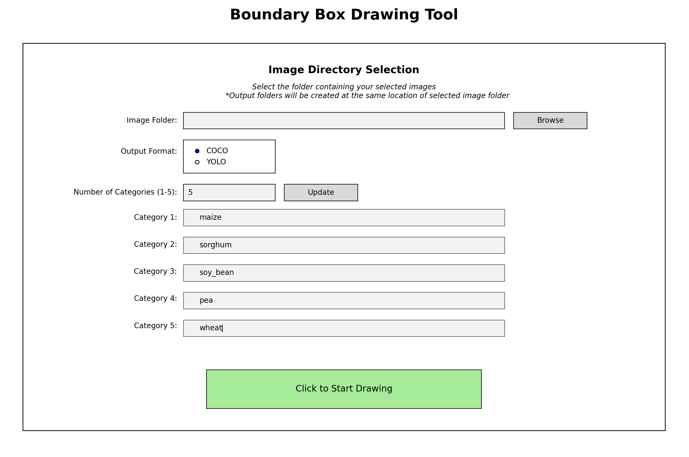
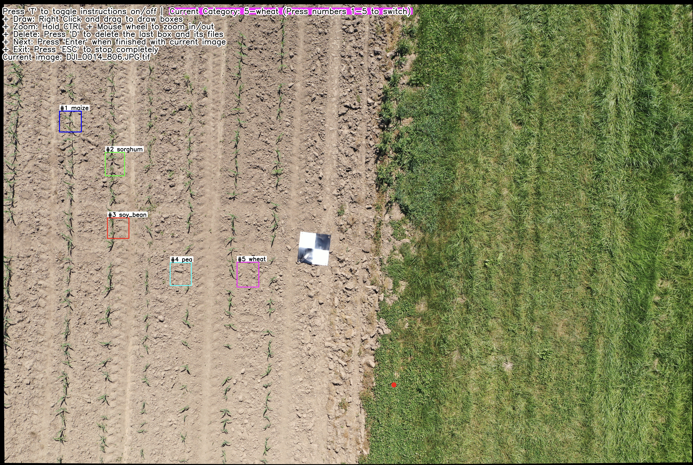

# 4 · BBox Drawer

**Stage 2 · Build the dataset** · **Type: Desktop app** · [← Back to MatchPlant](../README.md)

Draw bounding boxes around objects (for example, individual plants) by hand to create training labels. Set up to five categories and choose COCO (`.json`) or YOLO (`.txt`) output.

| | |
| --- | --- |
| **Input** | A folder of images, usually `selected_undistorted_images_<timestamp>/` from [3 Minimum Image Finder](../3_min_img_finder/README.md) |
| **Output** | `img_box/` (images with boxes and their annotation files) and `mask_box/` (one cropped image per box), next to the image folder |
| **Previous step** | [3 Minimum Image Finder](../3_min_img_finder/README.md) |
| **Next step** | [5 Image Splitter](../5_img_splitter/README.md): use `img_box/` as the annotation folder (COCO format) |

## Run it from the dashboard

1. On the dashboard home, select **BBox Drawer**.
2. If the page reports missing packages, click **Install requirements** and wait for it to finish.
3. Check the **Operating system** selection, then click **Launch**. A Boundary Box Drawing Tool window opens.
4. Fill in the required information:
   - **Image Folder**: click **Browse...** and choose your image folder.
   - **Output Format**: COCO or YOLO. Choose **COCO** to continue with Image Splitter and model training.
   - **Number of Categories (1-5)**: enter a number and click **Update**.
   - **Category names**: for example `maize`.
5. Click **Click to Start Drawing**.
6. Draw a box around each object (see [Drawing boxes](#drawing-boxes)), then press **Enter** for the next image.

Keep the dashboard running while you use the window. Messages and errors appear in the dashboard **Output** panel.



*Setup window*

## Drawing boxes

| Control | Action |
| --- | --- |
| Right-click and drag | Draw a box |
| **1**–**5** | Switch category |
| **D** | Delete the last box |
| **T** | Show or hide the on-screen instructions |
| **Enter** | Save this image's boxes and go to the next image |
| **Esc** | Save this image's boxes and stop |

Each category has its own color. Labels are saved when you press Enter or Esc.



*Drawing window*

## Inputs

- A folder of JPG/JPEG, PNG, or TIF/TIFF images.

## Outputs

Created in the folder that contains your image folder:

```text
├── selected_undistorted_images_.../   # your input images
├── img_box/                           # → Image Splitter "Annotation Folder"
│   ├── image1.jpg                     # image with boxes drawn
│   ├── image1_annotations.json        # (or .txt for YOLO)
│   └── ...
└── mask_box/                          # one cropped image and label per box
    ├── image1_1.jpg
    ├── image1_1.json
    └── ...
```

See [annotation formats](annotation_format.md) for the COCO and YOLO file structures.

## Run without the dashboard

From this folder, install the requirements for your system and start the tool:

```bash
# Windows
pip install -r requirements_win.txt
python bbox_drawer_win.py

# macOS
pip install -r requirements_mac.txt
python bbox_drawer_mac.py
```

Keep the repository's [matchplant_ui](../matchplant_ui/README.md) folder beside this module; the Browse button uses it. Windows dialogs use Python's built-in `tkinter`; if a custom Python build lacks it, choose a Python that includes it.

## Troubleshooting

- **Boxes are not drawn:** use the right mouse button and click the image window first so it has focus.
- **Wrong category:** press the number key for the category before drawing; check the color.
- **Nothing saved:** press Enter or Esc to save, and check that you can write to the folder.

## License

MIT License. See [LICENSE](../LICENSE).
