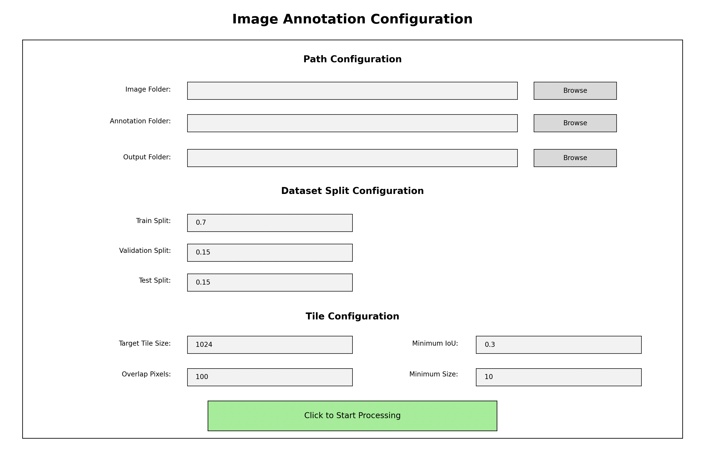
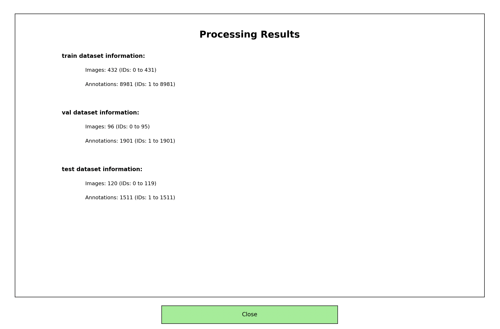

# 5 · Image Splitter

**Stage 2 · Build the dataset** · **Type: Desktop app** · [← Back to MatchPlant](../README.md)

Tile large images and their COCO annotations into smaller tiles, and split them into training, validation, and test sets with matching annotations. Boxes are adjusted to each tile, and objects cut by a tile edge are kept or dropped based on your settings.

| | |
| --- | --- |
| **Input** | An image folder and a folder of COCO annotation files (`*_annotations.json`) |
| **Output** | `data/train`, `data/val`, `data/test` tiles and `annotations/train.json`, `val.json`, `test.json` |
| **Previous step** | [3 Minimum Image Finder](../3_min_img_finder/README.md) (images) and [4 BBox Drawer](../4_bbox_drawer/README.md) (annotations in `img_box/`) |
| **Next step** | [6-1 Object Detection Trainer](../6-1_obj_det_trainer/README.md) or [6-2 Transfer Learning](../6-2_obj_det_trans_learner/README.md) |

Using the MatchPlant [dataset on Zenodo](../README.md#download-dataset)? Start here with its UAV images and annotation files.

## Run it from the dashboard

1. On the dashboard home, select **Image Splitter**.
2. If the page reports missing packages, click **Install requirements** and wait for it to finish.
3. Check the **Operating system** selection, then click **Launch**. An Image Annotation Configuration window opens.
4. Under **Path Configuration**, click **Browse...** for each folder:
   - **Image Folder**: your images (for example `selected_undistorted_images_.../`).
   - **Annotation Folder**: the folder of COCO `*_annotations.json` files (for example `img_box/`).
   - **Output Folder**: where the dataset will be written.
5. Set the **Dataset Split Configuration** and **Tile Configuration** (defaults below).
6. Click **Click to Start Processing** and review the results summary.

Keep the dashboard running while you use the window. Messages and errors appear in the dashboard **Output** panel.



*Setup window*

## Inputs

```text
images/                          # Image Folder (TIF/TIFF, JPG/JPEG, PNG)
├── image1.tif
└── ...
annotations/                     # Annotation Folder (COCO JSON)
├── image1_annotations.json
└── ...
```

## Settings

**Dataset split** (the three values must add up to 1.0):

| Setting | Default |
| --- | --- |
| Train Split | 0.7 |
| Validation Split | 0.15 |
| Test Split | 0.15 |

**Tiles:**

| Setting | Default | Notes |
| --- | --- | --- |
| Target Tile Size | 1024 px | Images are divided into a grid of about this size; smaller images stay unchanged. 512–2048 is typical. |
| Overlap Pixels | 100 px | Overlap between neighboring tiles, so objects at edges are not lost. About 10–20% of the tile size. |
| Minimum IoU | 0.3 | How much of a cut object must be inside a tile to keep it. Higher keeps only more complete objects (0–1). |
| Minimum Size | 10 px | Drops box fragments smaller than this width or height. 5–20 is typical. |

## Outputs

```text
output_folder/
├── data/
│   ├── train/    image1_r1c1.tif, ...
│   ├── val/
│   └── test/
└── annotations/
    ├── train.json
    ├── val.json
    └── test.json
```

Tile names end with their row and column (`_r1c1`), which [8 Image-to-Ortho Projector](../8_img_to_ortho/README.md) uses to place detections back on the original image.

These folders are the inputs for training (`data/train`, `data/val` + `annotations/train.json`, `val.json`) and testing (`data/test` + `annotations/test.json`).



*Results summary*

## Run without the dashboard

From this folder, install the requirements for your system and start the tool:

```bash
# Windows
pip install -r requirements_win.txt
python img_splitter_win.py

# macOS
pip install -r requirements_mac.txt
python img_spliter_mac.py
```

Keep the repository's [matchplant_ui](../matchplant_ui/README.md) folder beside this module; the Browse buttons use it.

## Troubleshooting

- **Out of memory:** use a smaller tile size, fewer images, or close other programs.
- **Missing annotations:** check that each image has a matching `<image name>_annotations.json` in COCO format.
- **Too few objects in tiles:** lower Minimum IoU or Minimum Size, or increase Overlap Pixels.
- **Split ratios rejected:** make sure Train + Validation + Test = 1.0.

## License

MIT License. See [LICENSE](../LICENSE).
