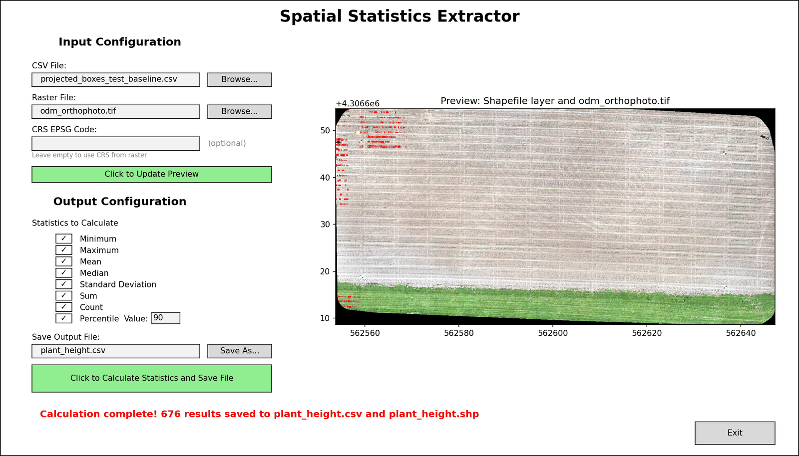

# 9 · Spatial Stats Extractor

**Stage 4 · Locate and analyze** · **Type: Desktop app** · [← Back to MatchPlant](../README.md)

Extract per-plant statistics from a raster, such as plant height from a canopy height model (CHM) or NDVI from a vegetation index map. Choose the detections file and a raster, preview the boxes on the map, pick statistics, and export the results as a CSV table and a shapefile for GIS software.

| | |
| --- | --- |
| **Input** | `projected_boxes.csv` from [8 Image-to-Ortho Projector](../8_img_to_ortho/README.md), and a georeferenced raster (GeoTIFF) |
| **Output** | A CSV with one row per box, and a shapefile (`.shp`) of the boxes with the same statistics |
| **Previous step** | [8 Image-to-Ortho Projector](../8_img_to_ortho/README.md) |

## Run it from the dashboard

1. On the dashboard home, select **Spatial Stats Extractor**.
2. If the page reports missing packages, click **Install requirements** and wait for it to finish.
3. Check the **Operating system** selection, then click **Launch**. A Spatial Statistics Extractor window opens.
4. Under **Input Configuration**:
   - **CSV File**: click **Browse...** and choose `projected_boxes.csv`.
   - **Raster File**: click **Browse...** and choose your raster, for example a CHM `.tif`.
   - **CRS EPSG Code**: leave empty to use the raster's coordinate system.
5. Click **Click to Update Preview** to check that the boxes sit on the plants (one box per plant).
6. Under **Output Configuration**, tick the **Statistics to Calculate** and set the percentile **Value** if needed.
7. Click **Save As...** to choose the output CSV name, then **Click to Calculate Statistics and Save File**. The shapefile is saved next to the CSV with the same name.

Keep the dashboard running while you use the window. Messages and errors appear in the dashboard **Output** panel.



*The window after a run: inputs and statistics on the left, detected boxes (red) over the orthomosaic on the right, and the saved CSV and shapefile in the status line*

## Inputs

- **CSV file**: `projected_boxes.csv` from [8 Image-to-Ortho Projector](../8_img_to_ortho/README.md). Columns 1–6 hold each box's affine transform and column 10 its pixel size `"(0, 0), (w, h)"` (see [Module 8 output](../8_img_to_ortho/README.md#outputs)).
- **Raster file**: GeoTIFF (`.tif`/`.tiff`) or another Rasterio-supported format with a coordinate system, for example:
  - a canopy height model (CHM) for plant height
  - a vegetation index map (for example NDVI)
  - the orthomosaic from [2 ODM Runner](../2_odm_runner/README.md)
- **CRS EPSG code** (optional): only if the boxes use a different coordinate system than the raster.

## Statistics

Minimum, maximum, mean, median, standard deviation, sum, count, and a percentile (default 90th).

Only valid pixels inside each box are used: pixels equal to the raster's **nodata** value (for example -9999) and empty (NaN) pixels are skipped, and `count` is the number of valid pixels. A box with no valid pixels gets `count` 0 and blank statistics. If your raster marks empty areas with a number but has no nodata value set, set it first (for example in QGIS) so those pixels are not counted.

## Outputs

For an output named `plant_height.csv`:

```text
├── plant_height.csv                          # statistics table
└── plant_height.shp (+ .shx, .dbf, .prj, .cpg)  # one polygon per box, same statistics
```

**CSV:** one row per box: `box_id`, the box corners (`ul_x`, `ul_y`, `lr_x`, `lr_y`), then one column per statistic.

| box_id | ul_x | ul_y | lr_x | lr_y | min | max | mean | median | std | sum | count | percentile_90 |
| --- | --- | --- | --- | --- | --- | --- | --- | --- | --- | --- | --- | --- |
| 1 | 605805.5060 | 3766997.0630 | 605914.8966 | 3766879.7401 | 0.0156 | 0.1938 | 0.0837 | 0.0812 | 0.0421 | 6124.83 | 73182 | 0.1412 |
| 2 | 605805.9583 | 3766881.9673 | 605915.8652 | 3766764.8903 | 0.0203 | 0.2104 | 0.0924 | 0.0897 | 0.0458 | 6182.13 | 66912 | 0.1535 |

**Shapefile:** each box as a polygon with the same fields, ready to open in QGIS or ArcGIS. It uses the EPSG code you entered, or the raster's coordinate system. Shapefile field names are limited to 10 characters, so the percentile column is named `p90` (for the 90th percentile). Keep all the files with the same name together. An existing shapefile with the same name is replaced.

## Run without the dashboard

From this folder, install the requirements for your system and start the tool:

```bash
# Windows
pip install -r requirements_win.txt
python stat_extractor_win.py

# macOS
pip install -r requirements_mac.txt
python stat_extractor_mac.py
```

Keep the repository's [matchplant_ui](../matchplant_ui/README.md) folder beside this module; the Browse buttons use it.

## Troubleshooting

- **Boxes do not appear or are in the wrong place:** check that the raster and boxes use the same coordinate system, or enter the boxes' EPSG code.
- **Preview is coarse:** large rasters are downsampled automatically for the preview.
- **Calculation errors:** select at least one statistic and use a percentile between 0 and 100.
- **Cannot save:** close the output file if it is open in another program and check folder permissions.
- **"Shapefile not saved" in the status line:** the CSV was still saved. Check the message, and install requirements again from the dashboard (the shapefile needs `pyogrio`).

## License

MIT License. See [LICENSE](../LICENSE).
