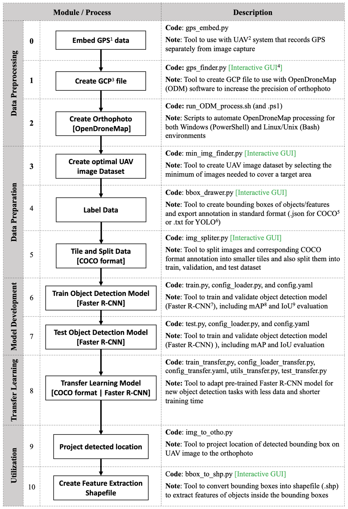

# MatchPlant


**From drone imagery to plant-level data.**

MatchPlant is an open-source pipeline for automated detection of individual objects in UAV (Unmanned Aerial Vehicle)-derived imagery. It detects individual plants in UAV images and locates the results on an orthomosaic. Run all 11 tools on your own computer from one local dashboard, with no coding.

- Interactive tools for preparing and annotating UAV imagery
- Faster R-CNN detection trained on high-resolution, undistorted UAV images
- Projects detections back onto the orthomosaic to extract digital plant traits

**Website:** [matchplant-dashboard.github.io](https://matchplant-dashboard.github.io) · **Paper:** [Smart Agricultural Technology (2026)](https://doi.org/10.1016/j.atech.2026.102421) · **Dataset:** [Zenodo](https://zenodo.org/records/14856123)

## Watch a Dashboard Example

See how to use the dashboard before installing (2 min 26 sec): the dashboard home, then step-by-step runs of GCP Finder, BBox Drawer, Object Detection Trainer, and Spatial Stats Extractor.

https://github.com/user-attachments/assets/890a01ff-29d3-4dbc-b7bb-10c7b17b1035

## Table of Contents
- [Watch a Dashboard Example](#watch-a-dashboard-example)
- [Run MatchPlant Locally](#run-matchplant-locally)
- [Using the Dashboard](#using-the-dashboard)
- [The Pipeline](#the-pipeline)
- [Requirements](#requirements)
- [Command-Line Use](#command-line-use)
- [Download Dataset](#download-dataset)
- [Citation](#citation)
- [Authors](#authors)
- [Contact](#contact)
- [Acknowledgments](#acknowledgments)
- [License](#license)

## Run MatchPlant Locally

Download once, then launch from your computer. The dashboard opens in your browser; all processing and the desktop tools run on your own machine.

1. **[Download MatchPlant ZIP](https://github.com/JacobWashburn-USDA/MatchPlant/archive/refs/heads/main.zip)** (or `git clone https://github.com/JacobWashburn-USDA/MatchPlant.git`).
2. Unzip it and open the **[dashboard](dashboard/)** folder. Keep its contents together.
3. Double-click the files for your system:

| System | Once: setup | Every time: start |
| --- | --- | --- |
| macOS | `1_Setup_macOS.command` | `2_Start_macOS.command` |
| Windows | `1_Setup_Windows.bat` | `2_Start_Windows.bat` |

Start opens the dashboard automatically at http://127.0.0.1:5050. Keep the MatchPlant Dashboard server window open while working; closing it stops the dashboard.

**If setup cannot find Python 3.9+:** follow the choices in the setup window (**P** for Python downloads, **A** for Anaconda, **E** to enter the path of an existing Python), then run the same setup file again.

<details>
<summary><b>macOS: "Not Opened" warning</b></summary>

If macOS cannot verify `1_Setup_macOS.command` or `2_Start_macOS.command`, that file has not run. First confirm that your download came from the official [MatchPlant repository](https://github.com/JacobWashburn-USDA/MatchPlant). Then:

1. Click **Done** in the warning.
2. Open **System Settings → Privacy & Security** and scroll to **Security**.
3. Click **Open Anyway** for the blocked file, then confirm **Open**.

If **Open Anyway** is missing, double-click the blocked file again and return to Privacy & Security. You may need to do this once for `1_Setup_macOS.command` and once for `2_Start_macOS.command`. See [Apple's instructions](https://support.apple.com/en-us/102445).

</details>

For terminal setup, developer details, and troubleshooting, see [dashboard/README.md](dashboard/README.md).

## Using the Dashboard

1. **Choose the step you need.** Select a module card on the dashboard home. The pipeline flow shows how the 11 modules connect; you can start at a later step if you already have its inputs.
2. **Read the instructions.** Each module page links to its README, source code, and requirements file. Check which inputs it needs and where it saves results.
3. **Install requirements, if needed.** If the page reports missing packages, click **Install requirements**. The dashboard creates a separate Python environment for that module and selects it automatically.
4. **Provide inputs and run.** For a form or training module, pick files and folders with **Browse…**, review the settings, and click **Run**. For a desktop app, click **Launch** and work in the window that opens. The **Output** panel shows live messages; **Stop** cancels a run.
5. **Check the results, then choose the next module.** Select the previous step's saved files as the next module's inputs. The dashboard does not pass results between modules automatically or run the whole pipeline at once.

You do not need to run every module. Skip a step when you already have the inputs for the next one.

**Module types** (shown as a tag on each module card):

| Type | What it means |
| --- | --- |
| **Desktop app** | Opens a separate desktop window on this computer. |
| **Form** | Enter inputs on the page, then run and follow the live log. |
| **Training** | Train or fine-tune a model using a settings form and live log. Transfer Learning also offers advanced YAML settings. |
| **Docker** | Processes a project through Docker, launched by Python. Requires Docker Desktop running. |

## The Pipeline

Four stages from image to insight. Use the modules as needed: 11 tools across four stages, where the two training routes at step 6 are alternatives.

| Stage | Module | Type | What it does |
| --- | --- | --- | --- |
| **1. Prepare imagery** | [0 GPS Embedder](0_gps_embeder/) | Form | Embed GPS coordinates into UAV image EXIF metadata before orthomosaic generation. |
| | [1 GCP Finder](1_gcp_finder/) | Desktop app | Right-click the ground control point (GCP) in each image to mark it, then save a `gcp_list.txt` for orthomosaic generation. |
| | [2 ODM Runner](2_odm_runner/) | Docker | Run OpenDroneMap on a project folder to generate the orthomosaic and DSM. |
| **2. Build the dataset** | [3 Minimum Image Finder](3_min_img_finder/) | Desktop app | Set overlap limits; the tool picks the smallest set of images that still covers the field, to minimize labeling effort. |
| | [4 BBox Drawer](4_bbox_drawer/) | Desktop app | Set up to five categories and an output format (COCO or YOLO), then draw bounding boxes by hand. |
| | [5 Image Splitter](5_img_splitter/) | Desktop app | Tile large images and split them into training, validation, and test sets with matching annotations. |
| **3. Train and test** | [6-1 Object Detection Trainer](6-1_obj_det_trainer/) | Training | Train a Faster R-CNN model on the tiled COCO datasets from Image Splitter. |
| | [6-2 Transfer Learning](6-2_obj_det_trans_learner/) | Training | *Or* fine-tune a pretrained Faster R-CNN checkpoint on a new dataset. |
| | [7 Object Detection Tester](7_obj_det_tester/) | Form | Evaluate a trained checkpoint on a held-out test split and report detection metrics. |
| **4. Locate and analyze** | [8 Image-to-Ortho Projector](8_img_to_ortho/) | Form | Project detected bounding boxes back onto the orthomosaic, producing `projected_boxes.csv`. |
| | [9 Spatial Stats Extractor](9_spatial_stats_extractor/) | Desktop app | Choose the detections file and a raster such as a canopy height model, pick statistics, and export per-plant results as a CSV and a shapefile. |

Modules tagged **Desktop app** open a window for the steps that need human input. Each module folder has its own README with inputs, outputs, and standalone usage. The shared [matchplant_ui](matchplant_ui/README.md) folder provides the file and folder pickers used by the desktop tools and the dashboard; keep it beside the module folders.

<details>
<summary><b>Workflow diagram from the paper</b></summary>



Figure 1: Diagram of the MatchPlant modular open-source pipeline (Sangjan et al., 2026). Some script names have changed since publication; the table above lists the current modules.

###### 1-GPS: Global Position System, 2-UAV: Unmanned Aerial Vehicle, 3-GCP: Ground Control Point, 4-GUI: Graphical User Interface, 5-COCO: Common Objects in Context, 6-YOLO: You Only Look Once, 7-Faster R-CNN: Faster Region-based Convolutional Neural Network

</details>

## Requirements

- macOS or Windows (the dashboard setup also prints instructions for Linux)
- Python 3.9+
- Docker Desktop, only for [2 ODM Runner](2_odm_runner/)
- A GPU is recommended for training (modules 6-1 and 6-2)
- Module packages are listed in each module's `requirements*.txt`; the dashboard installs them into a separate environment per module

Processing time, memory, and disk space depend on your dataset and settings.

## Command-Line Use

Every module can also run without the dashboard, for example on a workstation, cloud, or HPC system. Choose the module for your task, install its requirements, and follow its README. Command examples for training, testing, and projection are in [6-1 Object Detection Trainer](6-1_obj_det_trainer/README.md), [7 Object Detection Tester](7_obj_det_tester/README.md), and [8 Image-to-Ortho Projector](8_img_to_ortho/README.md).

## Download Dataset

Our maize case-study data is on [Zenodo](https://zenodo.org/records/14856123):

| File | Contents |
| --- | --- |
| [UAV images.zip](https://zenodo.org/records/14856123/files/UAV%20images.zip?download=1) | Undistorted UAV images (OpenDroneMap) from the 2021 growing season |
| [Annotation file.zip](https://zenodo.org/records/14856123/files/Annotation%20file.zip?download=1) | COCO bounding-box annotations for individual maize plants |
| [Pre-trained model_Faster R-CNN.pt](https://zenodo.org/records/14856123/files/Pre-trained%20model_Faster%20R-CNN.pt?download=1) | Faster R-CNN checkpoint for [6-2 Transfer Learning](6-2_obj_det_trans_learner/) |

With the images and annotations, start at [5 Image Splitter](5_img_splitter/).

## Citation

If you use MatchPlant in your research, please cite:

```
Sangjan, W., Pandey, P., Best, N. B., & Washburn, J. D. (2026). MatchPlant: An Open-Source Pipeline
for UAV-Based Single-Plant Detection from Undistorted Images with Orthomosaic Projection.
Smart Agricultural Technology, 15, 102421. https://doi.org/10.1016/j.atech.2026.102421
```

[](https://doi.org/10.1016/j.atech.2026.102421)

For the dataset, please cite:

```
Sangjan, W., Pandey, P., Best, N. B., & Washburn, J. D. (2025). MatchPlant: An open-source pipeline 
for UAV-based single-plant detection and data extraction [Data set]. Zenodo. https://doi.org/10.5281/zenodo.14856123
```

[](https://doi.org/10.5281/zenodo.14856123)

## Authors

- Worasit Sangjan
- Piyush Pandey
- Norman B. Best
- Jacob D. Washburn

*USDA-ARS, Plant Genetics Research Unit, Columbia, MO, United States*

Dashboard developed by [Worasit Sangjan](https://worasitsangjan.github.io/).

## Contact

For questions and collaboration opportunities, please contact:

**Jacob D. Washburn**; Email: jacob.washburn@usda.gov

## Acknowledgments

This research was supported in part by an appointment to the Agricultural Research Service (ARS) Research Participation Program administered by the Oak Ridge Institute for Science and Education (ORISE) through an interagency agreement between the U.S. Department of Energy (DOE) and the U.S. Department of Agriculture (USDA). ORISE is managed by ORAU under DOE contract number DE-SC0014664. This research used resources provided by the SCINet project and/or the AI Center of Excellence of the USDA Agricultural Research Service, ARS project numbers 0201-88888-003-000D and 0201-88888-002-000D. Funding was also provided by the United States Department of Agriculture, Agricultural Research Service, SCINet Postdoctoral Fellows Program. All opinions expressed in this publication are the author’s and do not necessarily reflect the policies and views of USDA, DOE, or ORAU/ORISE.

## License

This project is licensed under the MIT License. For details, see the [LICENSE](LICENSE) file.
