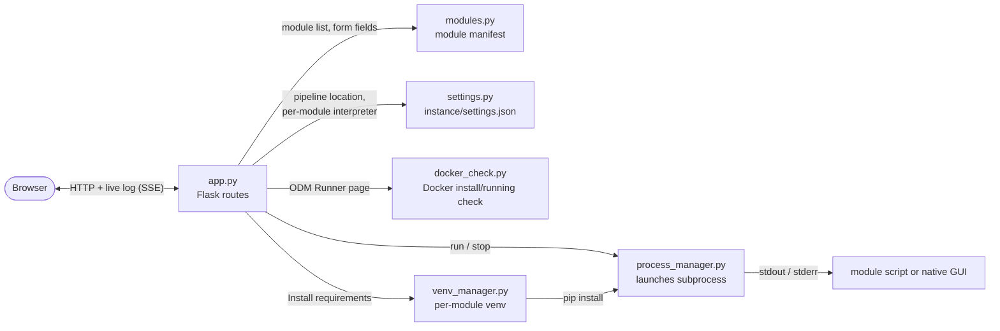

# MatchPlant Dashboard


A local web front end for the [MatchPlant](https://github.com/JacobWashburn-USDA/MatchPlant) pipeline,
included in this repository as the `dashboard/` folder.
Landing page: **[matchplant-dashboard.github.io](https://matchplant-dashboard.github.io)**.

- Lists all 11 pipeline modules across four stages (steps 0-9; the two step-6 training routes are alternatives), with a pipeline-flow card for jumping straight to any module
- Launch a module's native GUI, or run its CLI/script with real arguments
- Live log output streamed to the browser
- Downloaded together with the pipeline modules; the dashboard finds them automatically since they live in the same repository
- Runs entirely on your own machine. Desktop modules (GCP Finder, BBox Drawer, etc.) open a native GUI window on the machine running the dashboard, so don't deploy this to a remote server and expect the GUI to appear in your browser

## Setup

**No terminal experience? Double-click these files** in this folder, in order:

1. `setup.command` (Windows: `setup.bat`): checks for Python, tells you what to install if it's missing, and sets everything up. One-time only.
2. `start_dashboard.command` (Windows: `start_dashboard.bat`): starts the dashboard and opens it in your browser automatically. Run this every time you want to use the dashboard; On Windows, the launcher closes automatically; keep the separate "MatchPlant Dashboard" server window open. On macOS, keep the launcher terminal open while using the dashboard.

**Prefer the terminal?** Run the setup script. It checks for Python, tells you what to install if it's missing, and does the rest for you:

```bash
./setup.sh          # Windows: setup.bat
```

Then start the dashboard:

```bash
./.venv/bin/python app.py     # Windows: .venv\Scripts\python app.py
```

Then open http://127.0.0.1:5050

**Already comfortable with Python/venvs?** The manual equivalent:

```bash
python -m venv .venv
source .venv/bin/activate      # Windows: .venv\Scripts\activate
pip install -r requirements.txt
python app.py
```

## Windows setup and download guidance

The Windows launchers are included in this folder. Run `setup.bat` once, then use `start_dashboard.bat` to start the dashboard.

`setup.bat` checks a working dashboard environment, Python commands, an active Conda environment, common Anaconda/Miniconda locations, and conventional per-user Python installations. Candidates must actually run Python 3.9+. If none is found, press **P** for Python downloads, **A** for Anaconda downloads, or **C** to close. The first two options open the official download website; the user completes installation and runs setup again. Clickable terminal links depend on the terminal, so the keyboard menu is the reliable option.

On macOS, `setup.command` also checks a working dashboard environment, Python commands, and common Python, Homebrew, and Conda locations. If none has Python 3.9+ with `venv`, press **P** to open the official macOS Python downloads, **A** for Anaconda downloads, or **C** to close. Finish installing, then double-click `setup.command` again. The setup script does not install Python without your action. On Linux, `setup.sh` prints the download links for manual installation.

The dashboard installs Flask, PyYAML, and packaging from `requirements.txt`; module dependencies are installed separately. If updating an existing dashboard, rerun setup to install added dependencies.

## Forms and guidance

Use **Browse…** to select local folders and files, or paste/type paths. Output folders can be typed before they exist. Help icons show field explanations on hover, click, or keyboard focus; Escape closes them. Defaults remain visible. Read each module's README before running. These pickers select locations on the computer running the dashboard; they do not upload data.

## Connecting to the MatchPlant pipeline

- Since `dashboard/` lives inside the MatchPlant repository, the dashboard finds the pipeline modules automatically, no setup needed
- If you ever move this folder somewhere else, or want to point it at a different MatchPlant checkout, the **Settings** page inside the dashboard has a **Browse...** button that opens a native folder picker to relocate it

## Per-module Python environments

- Modules have very different dependencies (Tkinter-only GUIs, PyTorch training, GDAL/rasterio geospatial code), so one environment usually can't satisfy all of them
- Each module page checks its required package versions automatically and offers an **Install requirements** button that creates a dedicated environment for that module
- The **Settings** page lists which interpreter each module is using. Only needed if you already have a working environment (e.g. an existing PyTorch/CUDA setup) you'd rather point a module at instead

## Notes per module

- **ODM Runner** is launched by the cross-platform Python runner `run_ODM_process.py`, which calls Docker directly without PowerShell or Bash. It needs Docker Desktop running (the dashboard checks this live on that module's page), and needs a project folder path with an `images/` subfolder. Enter that path in the form; the script runs with that folder as its working directory.
- **GPS Embedder** takes UTM zone, hemisphere, and the image/events folder in its form. Standalone terminal prompts remain available.
- **Transfer Learning** uses a settings form with file and folder pickers. Run saves the settings to `transfer_config.yaml` before launching; an advanced YAML editor is also available.
- Modules with mac/win variants (GCP Finder, Min Image Finder, BBox Drawer, Image Splitter, Spatial Stats Extractor) auto-select the script for your OS; a dropdown lets you override it.

## Form validation and run controls

Browse buttons accept existing input files/folders; output fields also accept typed new folder paths. Required paths and numeric values are checked before a process starts. Relative input paths use the module folder, except Module 8’s DSM/output paths, which use its ODM dataset folder. Transfer Learning includes Browse fields for checkpoint and validation output folders.

Only one process per module runs at a time. **View log** reopens previous output without consuming another viewer’s log. A dropped log connection reconnects; **Stop** stops the launched process tree. Installing requirements uses the selected operating-system variant. Installed package versions are checked against requirements, but this is not a full runtime/hardware test.

The dashboard binds to localhost and starts with Flask debug/reloader disabled, avoiding extra development processes. Update an existing dashboard environment with `python -m pip install -r requirements.txt` to install the added `packaging` dependency.

## How it works



- `modules.py`: manifest of all pipeline modules, script location(s), kind (`gui`, `cli`, `config`, `shell`), and for CLI tools, the argparse-derived form fields. Resolves each module's folder against the MatchPlant pipeline location configured in Settings, not this dashboard's own folder.
- `process_manager.py`: launches each run as a subprocess and streams its stdout/stderr through a queue.
- `transfer_form.py`: reads and validates transfer-learning form values, updating the existing YAML configuration while retaining advanced values.
- `app.py`: Flask routes for the dashboard, module detail/form, run (`POST`), live log (`GET`, Server-Sent Events), and stop.
- `settings.py`: persists the MatchPlant pipeline location and per-module interpreter paths to `instance/settings.json` (not committed).
- `docker_check.py`: live Docker install/running check, used on the ODM Runner module page.
- `venv_manager.py`: creates a dedicated virtual environment per module (used by the **Install requirements** button), so one module's dependencies never collide with another's.
- `static/logo.png`, `static/images/img.png`: the dashboard's own bundled branding and pipeline-diagram assets (independent of wherever the MatchPlant pipeline is located).

## Dashboard module badges

- **Desktop app:** GCP Finder, Minimum Image Finder, BBox Drawer, Image Splitter, and Spatial Stats Extractor open a separate desktop window.
- **Form:** GPS Embedder, Object Detection Tester, and Image-to-Ortho Projector use page inputs and a live log.
- **Training:** Both training routes use settings forms and live logs; Transfer Learning also has an advanced YAML editor.
- **Docker:** ODM Runner calls Docker through Python.

These user-facing badges are separate from the internal execution categories.
